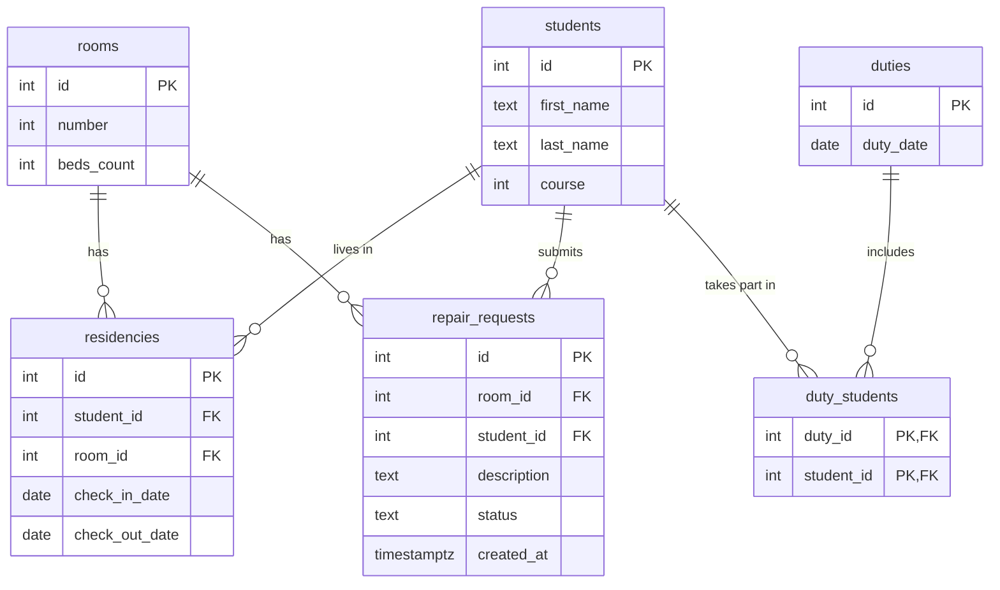

# Общежитие: база данных

Тема № 23: **общага**. База хранит информацию о комнатах общежития, студентах, их заселениях, заявках на ремонт и графике дежурств; она нужна коменданту и администрации общежития.

| | |
| --- | --- |
| Главная таблица | `residencies` (заселения): связывает студентов с комнатами |
| Связь N:M | `students` и `duties` через `duty_students` |
| Бизнес-правило | В комнате не больше жильцов, чем кроватей |
| СУБД | PostgreSQL 17 в Docker |
## Задания курса

Правила курса, установка и порядок сдачи: [docs/README.md](docs/README.md).

| Лаба | Задание |
| --- | --- |
| 1. Модель данных и схема | [docs/lab-1.md](docs/lab-1.md) |
| 2. Запросы | [docs/lab-2.md](docs/lab-2.md) |
| 3. Логика в базе | [docs/lab-3.md](docs/lab-3.md) |
| 4. Транзакции и доступ | [docs/lab-4.md](docs/lab-4.md) |
| 5. Производительность | [docs/lab-5.md](docs/lab-5.md) |
| Витрина к защите | [docs/showcase.md](docs/showcase.md) |

## Как запустить

```bash
cp .env.example .env          # пароли и порт
docker compose up -d          # при первом запуске выполняются скрипты из db/
dbcheck run demo/lab1.sql     # сценарий лабы 1
```

Работа с базой: `docker compose exec db psql -U postgres -d app`. Сценарии выполняются в `psql` командой `\i /demo/lab1.sql`.

После изменения скриптов в `db/` базу нужно пересоздать: `docker compose down -v && docker compose up -d`.

## ER-диаграмма



## Нормализация

### Исходная таблица

Если бы все данные о заселениях хранились в одной таблице `dormitory_all`, она выглядела бы так:

| residency_id | first_name | last_name | course | room_number | beds_count | check_in_date | check_out_date |
| --- | --- | --- | --- | --- | --- | --- | --- |
| 1 | Татьяна | Арбуз | 5 | 100 | 2 | 2025-08-31 | 2026-08-31 |
| 2 | Любовь | Дерево | 1 | 100 | 2 | 2025-09-01 | NULL |
| 3 | Анна | Ветер | 2 | 102 | 2 | 2025-09-01 | 2026-01-31 |
| 4 | Анна | Ветер | 2 | 103 | 3 | 2026-02-01 | NULL |
| 5 | Валерия | Гриб | 4 | 103 | 3 | 2025-09-01 | 2026-06-16 |

### Где был бы повтор данных

- **Данные студента.** Если студент переезжает, его имя, фамилия и курс записываются заново в каждой строке заселения (Анна Ветер в строках 3 и 4). При переходе на следующий курс пришлось бы исправлять все его строки, и в какой-то можно забыть.
- **Данные комнаты.** Номер комнаты и количество кроватей повторяются в каждой строке заселения (комнаты 100 и 103 встречаются дважды). При добавлении кровати пришлось бы менять много строк.

Такой повтор называется аномалией: данные можно исправить в одном месте и оставить старыми в другом.

### Как повтор убран

Данные разделены по сущностям, и каждое свойство хранится только в таблице своей сущности:

| Что повторялось | Куда вынесено |
| --- | --- |
| имя, фамилия, курс студента | `students` |
| номер комнаты, количество кроватей | `rooms` |
| кто, в какой комнате и когда жил | `residencies` (только `student_id`, `room_id` и даты) |

Таблица `residencies` ссылается на студента и комнату по ключу (`student_id`, `room_id`), поэтому курс студента или число кроватей хранится ровно в одном месте.

Аналогично устроены остальные части схемы: заявки на ремонт (`repair_requests`) хранят только ссылки на комнату и студента, а дежурства разделены на события (`duties`) и связующую таблицу `duty_students`, чтобы не записывать дату дежурства отдельно для каждого дежурного.

### Нормальные формы

- **1НФ:** в каждой ячейке одно значение. Списков вроде «студенты: Анна, Борис» в ячейках нет, жильцы комнаты записаны отдельными строками в `residencies`.
- **2НФ:** в таблицах с составным ключом (`duty_students`) нет столбцов, зависящих от части ключа, потому что кроме самого ключа там ничего нет. В остальных таблицах ключ состоит из одного столбца `id`.
- **3НФ:** неключевые столбцы зависят только от ключа своей таблицы, а не друг от друга. Например, количество кроватей зависит от комнаты, а не от студента, поэтому лежит в `rooms`.

### Типы данных

- Моменты времени (`repair_requests.created_at`) хранятся в `timestamptz`, он учитывает часовой пояс.
- Даты без времени (`check_in_date`, `check_out_date`, `duty_date`) хранятся в `date`.
- Статус заявки ограничен тремя значениями через `CHECK (status IN ('accepted', 'in_progress', 'done'))`.
- Денег в теме нет, поэтому `numeric` не используется.

### Ограничения

| Ограничение | Таблица и колонки | Зачем                                                 |
| --- | --- |-------------------------------------------------------|
| `UNIQUE` | `rooms (number)` | в общежитии не может быть двух комнат с одним номером |
| `UNIQUE` | `residencies (student_id, check_in_date)` | студент не может заселиться дважды в один день        |
| `CHECK` | `rooms (beds_count)`: больше 0 | в комнате должна быть хотя бы одна кровать            |
| `CHECK` | `rooms (number)`: больше 0 | номер комнаты не может быть нулём или отрицательным   |
| `CHECK` | `students (course)`: от 1 до 6 | курс не может быть любым числом                       |
| `CHECK` | `residencies (check_out_date)`: не раньше `check_in_date` | нельзя выселиться раньше, чем заселился               |
| `CHECK` | `repair_requests (status)`: `accepted`, `in_progress` или `done` | у заявки только три допустимых статуса                |

## Что сделано по лабам

| Лаба | Что сделано | Сценарий |
| --- | --- | --- |
| 1 | 6 таблиц с ключами и ограничениями, ER-диаграмма, тестовые данные, три «плохие» вставки | `demo/lab1.sql` |
| 2 | ... | `demo/lab2.sql` |
| 3 | ... | `demo/lab3.sql` |
| 4 | ... | `demo/lab4.sql`, `demo/race.sql`, `demo/race_fixed.sql` |
| 5 | ... | `demo/lab5.sql` |
<!--
  Разделы, которые добавляются по ходу курса:
  лаба 1 ★: «Нормализация», «Типы данных»; ★★: «Что происходит при удалении»;
  лаба 4: «Гонка»;
  лаба 5: «Производительность» (таблица до / после, когда индекс не помогает, размеры).
-->
